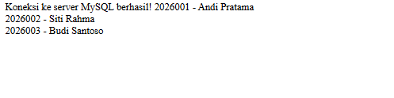
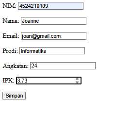
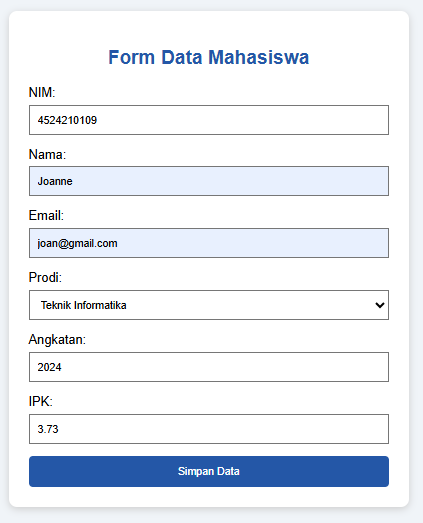
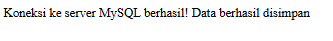
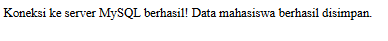

  <h1>LAPORAN PRAKTIKUM  
  PRAK. PEMROGRAMAN BERBASIS WEB</h1>

<b>Dosen Pengampu: </b> 
Ari Wibowo, S.Kom., M.Kom., C. Pro

 
 

 
 
 

<b>Disusun Oleh:</b> 
Joanne Trixie Isaura   4524210109

 
 

<h1>PROGRAM STUDI TEKNIK INFORMATIKA 
FAKULTAS TEKNIK  
UNIVERSITAS PANCASILA 
2026</h1>

 

  <h2>Tugas 5</h2>

 
<table>
  <tr>
    <th>File</th>
    <th>Gambar</th>
  </tr>

  <tr>
    <th>Koneksi</th>
    <th>
         
  </tr>
</table>

<b>Penjelasan:</b> 
Gambar pertama menunjukkan bahwa program berhasil melakukan koneksi ke server MySQL. Hal ini ditandai dengan munculnya pesan “Koneksi ke server MySQL berhasil!”. Pesan tersebut menunjukkan bahwa konfigurasi koneksi antara program PHP dan database MySQL telah berjalan dengan baik sehingga program dapat terhubung ke database yang digunakan.

 
<table>
  <tr>
    <th>File</th>
    <th>Gambar</th>
  </tr>

  <tr>
    <th>Data</th>
    <th>
  </tr>
</table>

<b>Penjelasan:</b> 
Gambar kedua menunjukkan bahwa program berhasil mengambil dan menampilkan data mahasiswa yang tersimpan di dalam database MySQL. Data yang ditampilkan berupa NIM dan nama mahasiswa, yang menunjukkan bahwa proses pengambilan data dari database telah berhasil dilakukan. Dengan demikian, program PHP tidak hanya berhasil terhubung ke server MySQL, tetapi juga dapat membaca dan menampilkan data sesuai dengan isi tabel dalam database.

 
<table>
  <tr>
    <th>File</th>
    <th>Sebelum</th>
    <th>Sesudah</th>
  </tr>

  <tr>
    <th>Form</th>
    <th>
    <th></th>
  </tr>
</table>

<b>Penjelasan:</b> 
Pada code sebelum, form digunakan untuk memasukkan data mahasiswa berupa NIM, nama, email, program studi, angkatan, dan IPK dengan tampilan yang masih sederhana. Pada code sesudah, form dimodifikasi dengan menambahkan CSS agar tampilannya lebih menarik dan rapi, serta menambahkan validasi input seperti NIM harus berupa angka, nama maksimal 100 karakter, program studi dipilih melalui dropdown, angkatan dibatasi sesuai tahun yang tersedia, dan IPK harus berada di antara 0 sampai 4. Selain itu, teks tombol diubah menjadi “Simpan Data” agar lebih jelas bagi pengguna.

 
<table>
  <tr>
    <th>File</th>
    <th>Sebelum</th>
    <th>Sesudah</th>
  </tr>
  
  <tr>
    <th>Simpan</th>
    <th></th>
    <th></th>
  </tr>
</table>

<b>Penjelasan:</b> 
Pada code sebelum, data mahasiswa langsung diambil dari form dan dimasukkan ke database menggunakan query INSERT, tanpa pemeriksaan data yang lebih lanjut. Pada code sesudah, ditambahkan validasi untuk memastikan form dikirim melalui metode POST, semua data wajib diisi, NIM harus berupa angka, email harus valid, angkatan harus sesuai, dan IPK berada di antara 0 sampai 4. Selain itu, query diubah menggunakan prepared statement agar penyimpanan data lebih aman, serta ditambahkan try-catch untuk menangani kesalahan, seperti NIM atau email yang sudah terdaftar.

 
<table>
  
<b>Penjelasan singkat untuk lima bagian kode yang menurut saya paling penting:</b>

  
  <tr>
    <td>1. Koneksi ke database (koneksi.php)  
      
Kode mysqli_connect() digunakan untuk menghubungkan PHP dengan database MySQL bernama akademik. Jika koneksi gagal, program akan menampilkan pesan kesalahan sehingga proses tidak dilanjutkan.
</td>
  </tr>
  
  <tr>
    <td>2. Menampilkan data mahasiswa (data.php) 
      
Kode mysqli_query() menjalankan perintah SQL SELECT untuk mengambil data dari tabel mahasiswa. Selanjutnya, mysqli_fetch_assoc() mengambil data setiap baris agar NIM dan nama mahasiswa dapat ditampilkan.
</td>
  </tr>

  <tr>
    <td>3. Formulir input (form.php) 
      
Tag form dengan atribut action="simpan.php" dan method="post" digunakan untuk mengirim data mahasiswa ke file simpan.php. Atribut required, min, max, dan pattern membantu membatasi input agar data yang dimasukkan sesuai ketentuan.
</td>
  </tr>

  <tr>
    <td>4. Validasi data (simpan.php) 
      
Validasi digunakan untuk memeriksa apakah data sudah diisi dengan benar sebelum disimpan. Contohnya, NIM harus berupa angka, email harus memiliki format yang valid, dan IPK harus berada di antara 0 sampai 4. Validasi di server tetap diperlukan meskipun formulir sudah memiliki pembatasan input.
</td>
  </tr>

  <tr>
    <td>5. Menyimpan data dengan prepared statement (simpan.php) 
      
mysqli_prepare() dan mysqli_stmt_bind_param() digunakan untuk menyiapkan query serta mengikat nilai input ke parameter SQL. Cara ini membantu mencegah SQL injection, sedangkan mysqli_stmt_execute() menjalankan query untuk menyimpan data mahasiswa ke database.
</td>
  </tr>
</table>
