

  <h1>LAPORAN PRAKTIKUM  
  PRAK. PEMROGRAMAN BERBASIS WEB</h1>

<b>Dosen Pengampu: </b> 
Ari Wibowo, S.Kom., M.Kom., C. Pro

 
 

 
 
 

<b>Disusun Oleh:</b> 
Joanne Trixie Isaura   4524210109

 
 

<h1>PROGRAM STUDI TEKNIK INFORMATIKA 
FAKULTAS TEKNIK  
UNIVERSITAS PANCASILA 
2026</h1>

 

  <h2>Tugas 6</h2>

 
<table>
  <tr>
    <th>File</th>
    <th>Gambar</th>
  </tr>

  <tr>
    <th>Koneksi</th>
    <th>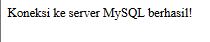
         
  </tr>
</table>

<b>Penjelasan:</b> 
Gambar pertama menunjukkan bahwa program berhasil melakukan koneksi ke server MySQL. Hal ini ditandai dengan munculnya pesan “Koneksi ke server MySQL berhasil!”. Pesan tersebut menunjukkan bahwa konfigurasi koneksi antara program PHP dan database MySQL telah berjalan dengan baik sehingga program dapat terhubung ke database yang digunakan.

 
<table>
  <tr>
    <th>File</th>
    <th>Sebelum</th>
    <th>Sesudah</th>
  </tr>

  <tr>
    <th>create</th>
    <th>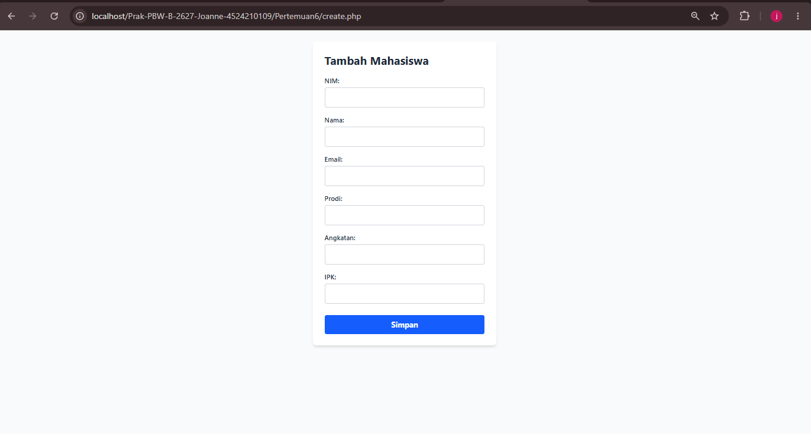
    <th>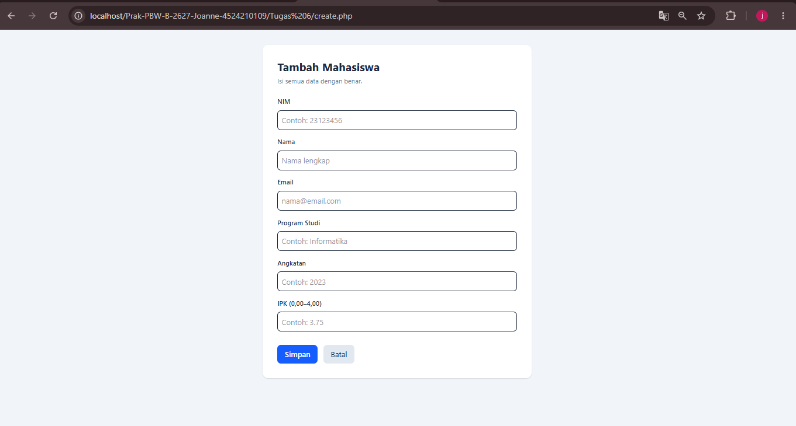</th>
  </tr>
</table>

<b>Penjelasan:</b> 
Pada kode sebelum modifikasi, form tambah mahasiswa hanya menggunakan atribut required untuk memastikan setiap kolom diisi, tetapi belum memiliki batasan khusus untuk panjang input, nilai IPK, dan angkatan. Pada kode sesudah modifikasi, ditambahkan validasi melalui atribut HTML, seperti maxlength untuk membatasi panjang karakter, minlength untuk menentukan panjang minimal nama, min dan max untuk membatasi nilai IPK antara 0 sampai 4 serta angkatan antara 2000 sampai 2099. Tipe input angkatan juga diubah dari text menjadi number agar pengguna memasukkan angka. Selain itu, ditambahkan tautan kembali ke halaman utama agar pengguna lebih mudah melakukan navigasi.

 
<table>
  <tr>
    <th>File</th>
    <th>Sebelum</th>
    <th>Sesudah</th>
  </tr>
  
  <tr>
    <th>index</th>
    <th>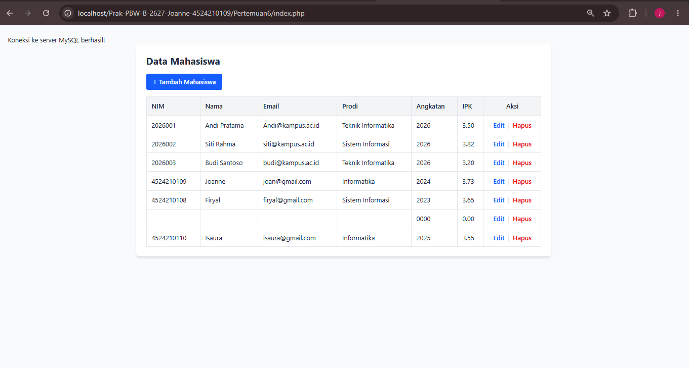</th>
    <th>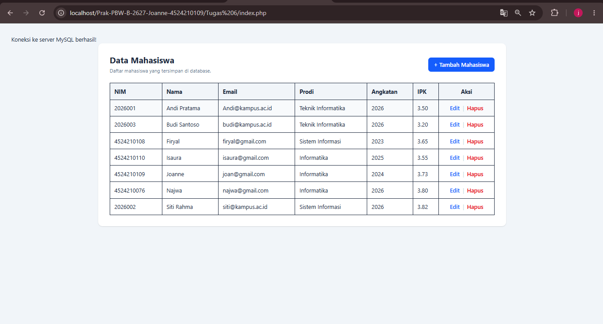</th>
  </tr>
</table>

<b>Penjelasan:</b> 
Pada kode sebelum modifikasi, index.php hanya menampilkan data mahasiswa dari database berupa NIM, nama, email, program studi, angkatan, IPK, serta aksi edit dan hapus. Pada kode sesudah modifikasi, ditambahkan kolom Keterangan IPK yang menampilkan status akademik berdasarkan nilai IPK, yaitu Sangat Memuaskan, Memuaskan, atau Perlu Peningkatan. Selain itu, ditambahkan kondisi untuk menampilkan pesan apabila belum ada data mahasiswa dan fungsi htmlspecialchars() untuk membantu mencegah karakter khusus pada data ditampilkan sebagai kode HTML. Parameter NIM pada tautan edit dan hapus juga menggunakan urlencode() agar lebih aman saat dimasukkan ke URL.

 
<table>
  <tr>
    <th>File</th>
    <th>Sebelum</th>
    <th>Sesudah</th>
  </tr>

  <tr>
    <th>update</th>
    <th>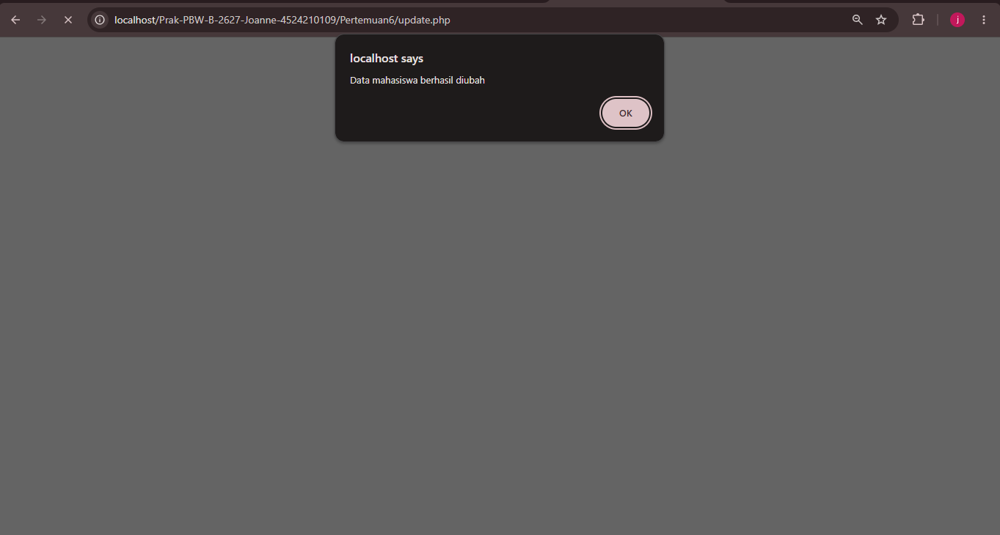
    <th></th>
  </tr>
</table>

<b>Penjelasan:</b> 

 
<table>
  <tr>
    <th>File</th>
    <th>Sebelum</th>
    <th>Sesudah</th>
  </tr>
  
  <tr>
    <th>edit</th>
    <th>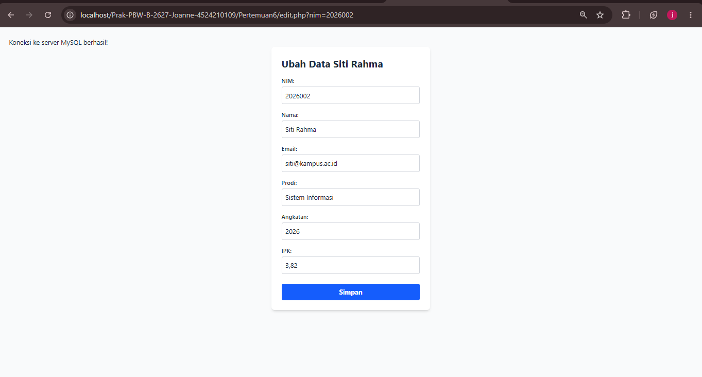</th>
    <th>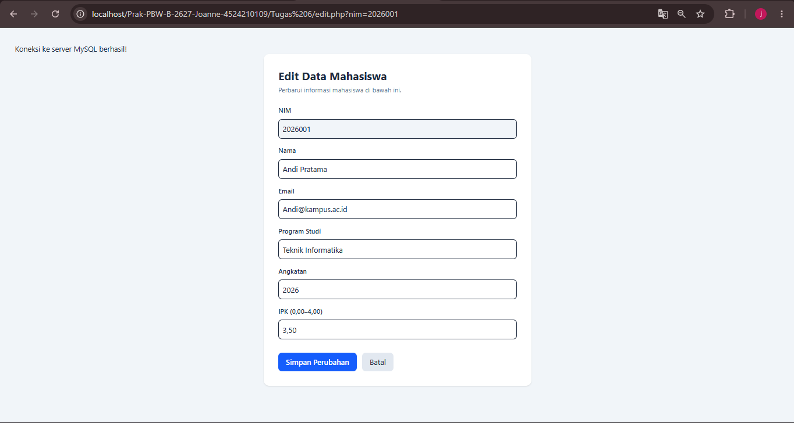</th>
  </tr>
</table>

<b>Penjelasan:</b> 

 
<table>
  <tr>
    <th>File</th>
    <th>Sebelum</th>
    <th>Sesudah</th>
  </tr>

  <tr>
    <th>delete</th>
    <th>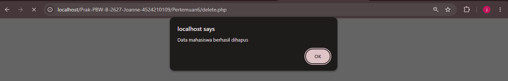
    <th>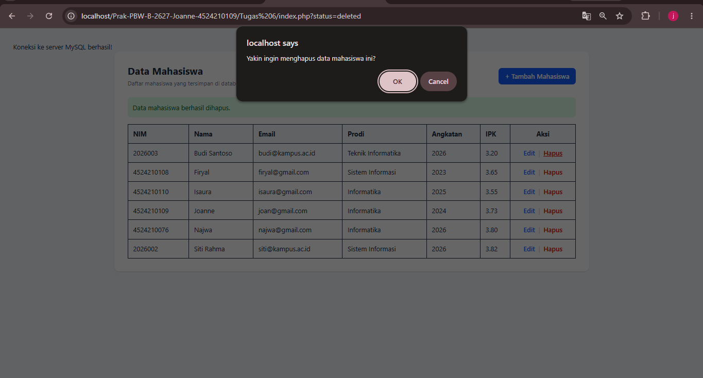 
    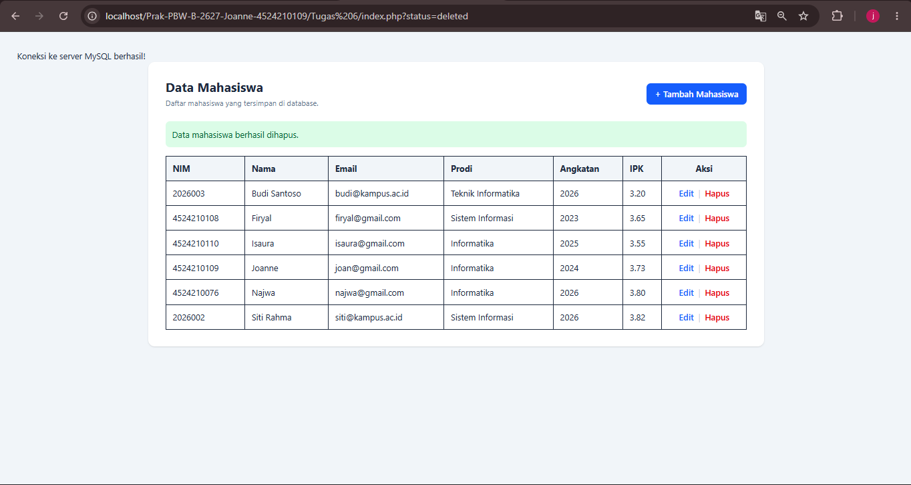</th>
  </tr>
</table>

<b>Penjelasan:</b> 

 
<table>
  <tr>
    <th>File</th>
    <th>Sebelum</th>
    <th>Sesudah</th>
  </tr>
  
  <tr>
    <th>store</th>
    <th></th>
    <th></th>
  </tr>
</table>

<b>Penjelasan:</b> 

 
<table>
  
<b>Penjelasan singkat untuk lima bagian kode yang menurut saya paling penting:</b>

  
  <tr>
    <td> 
      

</td>
  </tr>
  
  <tr>
    <td> 
      

</td>
  </tr>

  <tr>
    <td> 
      

</td>
  </tr>

  <tr>
    <td> 
      

</td>
  </tr>

  <tr>
    <td> 
      

</td>
  </tr>
</table>
