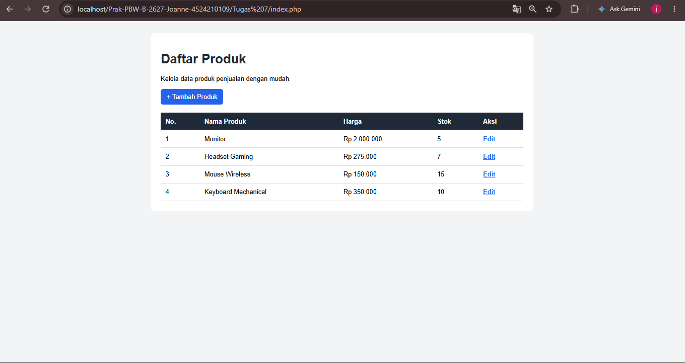

  <h1>LAPORAN PRAKTIKUM  
  PRAK. PEMROGRAMAN BERBASIS WEB</h1>

<b>Dosen Pengampu: </b> 
Ari Wibowo, S.Kom., M.Kom., C. Pro

 
 

 
 
 

<b>Disusun Oleh:</b> 
Joanne Trixie Isaura   4524210109

 
 

<h1>PROGRAM STUDI TEKNIK INFORMATIKA 
FAKULTAS TEKNIK  
UNIVERSITAS PANCASILA 
2026</h1>

 

  <h2>Tugas 7</h2>

<table align="center";>
  <tr>
    <th>index.php</th>
  </tr>

  <tr>
    <th>
  </tr>
</table>

<b>Penjelasan:</b> 
Gambar ini merupakan daftar produk yang telah tersimpan di dalam database dalam bentuk tabel. Tabel berisi nomor, nama produk, harga, stok, dan aksi edit. Halaman ini juga menyediakan tombol Tambah Produk untuk menambahkan produk baru serta fitur Edit untuk mengubah data produk yang sudah ada.

 
<table align="center";>
  <tr>
    <th>create.php</th>
  </tr>

  <tr>
    <th>
  </tr>
</table>

<b>Penjelasan:</b> 
Gambar ini merupakan halaman tambah produk yang digunakan untuk memasukkan data produk baru ke dalam sistem. Pengguna dapat mengisi nama produk, harga produk, dan stok produk, kemudian menekan tombol Simpan Produk untuk menyimpan data ke database.

 
<table align="center";>
  <tr>
    <th>edit.php</th>
  </tr>

  <tr>
    <th>
  </tr>
</table>

<b>Penjelasan:</b> 
Gambar ini merupakan halaman edit produk yang berfungsi untuk mengubah data produk yang sudah tersimpan. Formulir menampilkan data sebelumnya, seperti nama, harga, dan stok produk, sehingga pengguna dapat memperbarui informasi yang diperlukan dengan menekan tombol Simpan Perubahan.

 
<table align="center";>
  <tr>
    <th>Database</th>
  </tr>

  <tr>
    <th>
  </tr>
</table>

<b>Penjelasan:</b> 
Gambar ini merupakan database akademik yang memiliki tabel produk yang digunakan untuk menyimpan data barang atau produk. Tabel ini terdiri dari empat kolom, yaitu id sebagai identitas unik produk, nama_produk sebagai nama barang, harga sebagai harga produk, dan stok sebagai jumlah persediaan barang. Pada tabel tersebut terdapat 4 data produk, yaitu Keyboard Mechanical, Mouse Wireless, Headset Gaming, dan Monitor.

